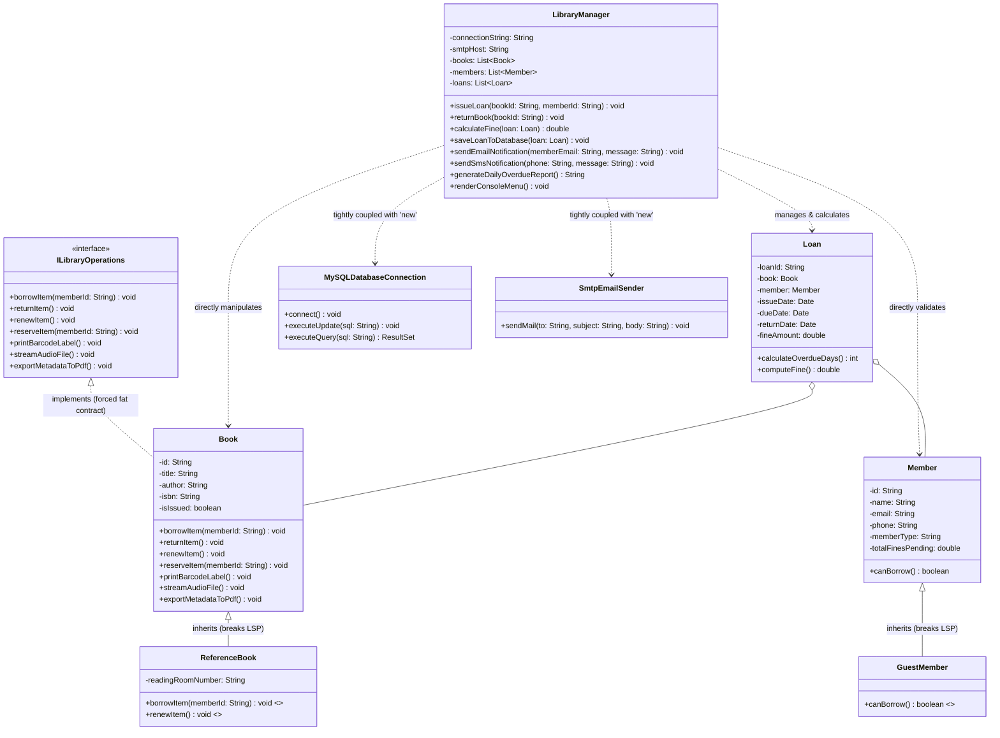

# Initial System Design (Before SOLID Application)
**ICT 431-2 Object Oriented Design Patterns and Principals**  
**Assessment:** Group Project (Library Management System)  
**Ticket:** `LMS-EP1-01: Domain Modeling & Monolithic Class Design`  
**Target Report Sections:** Section 2.1 & Section 2.2

---

## 2.1 Problem Description & Business Domain

### 2.1.1 Domain Overview
The system models a university library handling four core business entities:
1. **Book:** Represents physical and reference library materials with metadata (ISBN, Title, Author, Category, Borrowing Status).
2. **Member:** Represents registered patrons (e.g., Undergraduate Student, Faculty Member, and Guest/Visitor).
3. **Loan:** Tracks the borrowing lifecycle (Issue Date, Due Date, Return Date, Overdue Calculation, and Fine Incurred).
4. **Notification:** Communicates alerts (Loan issued confirmation, Due date reminders, and Overdue fine warnings) via communication channels (Email, SMS).

### 2.1.2 Problem Statement & Architectural Flaws
In the initial un-refactored system, the system was designed following procedural, ad-hoc object-oriented practices commonly found in naive legacy systems. While the system appears superficially operational for basic happy-path cases, it severely violates every core object-oriented design principle:

1. **Monolithic God Class (`LibraryManager`):**  
   Contains user interaction, business transaction logic, direct SQL string persistence, and hardcoded notification dispatches. Changing any one detail forces recompilation and risks breaking completely unrelated features (**SRP Violation**).
2. **Hardcoded Branching Logic:**  
   Fine calculations and loan durations are computed via cascaded `if-else` and `switch` blocks inspecting raw member type strings or integers. Introducing a new membership tier (e.g., `PostgraduateResearcher`) requires editing and re-testing core calculation routines (**OCP Violation**).
3. **Fragile Inheritance & Broken Subtyping:**  
   `ReferenceBook` inherits from `Book`, but reference materials cannot legally be borrowed. Rather than separating borrowing capabilities, `ReferenceBook.borrowItem()` throws `UnsupportedOperationException`. Any polymorphic iteration over books that calls `borrowItem()` will abruptly crash at runtime (**LSP Violation**).
4. **Fat, Coercive Interfaces (`ILibraryOperations`):**  
   A single interface forces all library items and entities to implement methods they have no use for (e.g., `borrow()`, `reserve()`, `renew()`, `printBarcode()`, `streamAudio()`, `exportToPdf()`). Implementing classes must resort to throwing dummy exceptions or providing blank bodies (**ISP Violation**).
5. **Direct Coupling to Low-Level Infrastructure:**  
   High-level business operations instantiate low-level concrete drivers directly (`new EmailService()`, `new MySQLDatabase()`) using `new` operators inside methods. It is impossible to unit-test the business logic with mocks, switch database providers, or introduce alternative notification channels without modifying high-level code (**DIP Violation**).

---

## 2.2 Initial Class Diagram (Before SOLID)

The following Mermaid UML diagram depicts the initial un-factored architecture, highlighting the tight coupling, bloated interfaces, and improper inheritance.

---

## 2.3 Intentional Design Flaws & Member Refactoring Matrix

| SOLID Principle | Violated Component(s) | Specific Architectural Flaw | Assigned Lead |
| :--- | :--- | :--- | :--- |
| **SRP** (Single Responsibility) | `LibraryManager` | Acts as a God Class combining business orchestration, persistence SQL execution, notification sending, report formatting, and input parsing. Has at least 5 distinct reasons to change. | **Member 1** |
| **OCP** (Open/Closed) | `LibraryManager.calculateFine()`, `Loan.computeFine()` | Hardcoded nested `switch(memberType)` / `if-else` blocks for calculating loan periods and overdue fines. Adding a new member tier requires modifying core existing classes. | **Member 2** |
| **LSP** (Liskov Substitution) | `ReferenceBook` extending `Book`, `GuestMember` extending `Member` | `ReferenceBook.borrowItem()` throws `UnsupportedOperationException`. Substituting `ReferenceBook` where `Book` is expected breaks client code at runtime. | **Member 3** |
| **ISP** (Interface Segregation) | `ILibraryOperations` | Fat interface forcing physical books, digital materials, and reference books to implement unused methods (`streamAudioFile()`, `printBarcodeLabel()`). | **Member 4** |
| **DIP** (Dependency Inversion) | `LibraryManager` direct instantiations | High-level module depends directly on low-level concrete classes (`new SmtpEmailSender()`, `new MySQLDatabaseConnection()`) instead of abstractions. | **Member 5** |

---

## 2.4 Deliverable Checklist for LMS-EP1-01
- [x] Clear domain specification for `Book`, `Member`, `Loan`, and `Notification`.
- [x] Formal Problem Description authored for Report Section 2.1.
- [x] Initial UML Class Diagram rendered in Mermaid for Report Section 2.2.
- [x] Flaw Identification Matrix cleanly dividing responsibilities across all 5 group members.
- [x] Readiness to begin `LMS-EP1-02` (Java code implementation of the un-refactored baseline).
